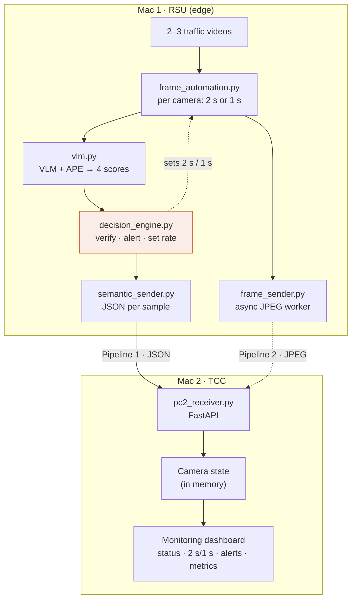

# RoadSense — edge AI traffic monitoring

> Sea x OpenAI Regional Codex Hackathon (Thailand) — 21 Nov 2026
> Team: **khun-chai (TEAM36)** · Tracks: Deep Domain AI · Autonomous & Adaptive AI

RoadSense analyzes CCTV at a simulated roadside unit with a vision-language model + Adaptive Prompt Ensemble,
samples each camera every 2 s and speeds up to 1 s only when it needs to verify an event, and sends compact
semantic results (plus selected snapshots) to a Traffic Control Center dashboard.

- Plan & context: [docs/master-plan.md](docs/master-plan.md)
- Contracts: [docs/api-contract.md](docs/api-contract.md)
- Team workflow: [CONTRIBUTING.md](CONTRIBUTING.md) · Codex rules: [AGENTS.md](AGENTS.md)

## Architecture

- The adaptive loop (`decision_engine` → `frame_automation`) runs on Mac 1 only.
- Pipeline 2 never blocks inference (bounded queue, drop stale previews).
- Payload fields and endpoints: [docs/api-contract.md](docs/api-contract.md).

## Provenance
- **Pre-event baseline (reused):** our research code for VLM + APE traffic-state inference (ICOIN 2027 submission). TODO: link baseline repo/commit.
- **Built during the event (from 10:00):** everything under `rsu/`, `tcc/`, `shared/`, `evaluation/`, `tests/`.
- An early scaffold made before hacking started is kept only in tag `pre-event-scaffold` and is **not** part of the submission.

## Run
TODO (fill in as modules land).

## Team — khun-chai (TEAM36)
| Name | GitHub | Role |
|---|---|---|
| Chaiyapat Anantarasuchart | [@erthcyp](https://github.com/erthcyp) | TODO |
| Chaitawat Boonkitticharoen | [@fongctw](https://github.com/fongctw) | TODO |
| Kanteeded Limkangwalmongkol | [@kantheedeth](https://github.com/kantheedeth) | TODO |
| Bhuchi Kumprakob | [@Bhuchi](https://github.com/Bhuchi) | TODO |
