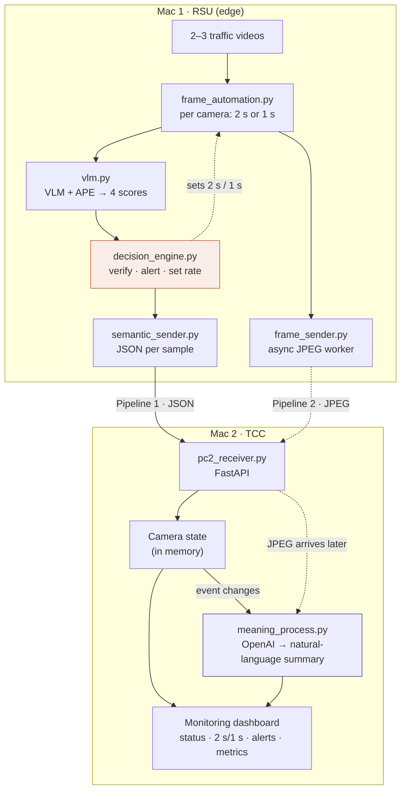

# RoadSense — edge AI traffic monitoring

> Sea x OpenAI Regional Codex Hackathon (Thailand) — 21 Nov 2026
> Team: **khun-chai (TEAM36)** · Tracks: Deep Domain AI · Autonomous & Adaptive AI

RoadSense analyzes CCTV at a simulated roadside unit with a vision-language model + Adaptive Prompt Ensemble,
samples each camera every 2 s and speeds up to 1 s only when it needs to verify an event, and sends compact
semantic results (plus selected snapshots) to a Traffic Control Center dashboard.

- Plan & context: [docs/master-plan.md](docs/master-plan.md)
- Contracts: [docs/api-contract.md](docs/api-contract.md)
- Team workflow: [CONTRIBUTING.md](CONTRIBUTING.md) · Codex rules: [AGENTS.md](AGENTS.md)

## Architecture



- The adaptive loop (`decision_engine` → `frame_automation`) runs on Mac 1 only.
- `meaning_process` (Mac 2) turns JSON into an operator-readable summary with OpenAI first, then refines it when the matching JPEG arrives. It runs async and never delays the dashboard.
- Pipeline 2 never blocks inference (bounded queue, drop stale previews).
- Each sample → 1×4 softmax scores + camera metadata (location from `rsu/cameras.json`) sent as JSON.
- Payload fields and endpoints: [docs/api-contract.md](docs/api-contract.md).

## Provenance
- **Pre-event baseline (reused):** our research code for VLM + APE traffic-state inference (ICOIN 2027 submission). TODO: link baseline repo/commit.
- **Built during the event (from 10:00):** everything under `rsu/`, `tcc/`, `shared/`, `evaluation/`, `tests/`.
- An early scaffold made before hacking started is kept only in tag `pre-event-scaffold` and is **not** part of the submission.

## Run

The OpenCV sampler and VLM runner support local video predictions and an optional
preview window. Adaptive decisions and network transport still need to be connected.

```bash
python3 -m venv .venv
source .venv/bin/activate
pip install -r requirements-frame.txt -r requirements-rsu.txt
python -m rsu.frame_automation --video CAM_01=assets/demo_clips/traffic.mp4
```

This prints frame metadata as JSON, in real time, **every 1 second by default**.
Override with `--interval-sec 2` for the planned normal monitoring rate. Repeat
`--video CAM_02=assets/demo_clips/another.mp4` for independent camera feeds.
Optional `--output-dir /tmp/roadsense-frames` saves sampled JPEGs for inspection;
`--no-realtime` extracts offline as fast as decoding permits. Clips stop at EOF
(or decode failure); Ctrl-C releases the video handles. Video files stay local.
The CLI only extracts frames and does not classify them or send predictions.
The VLM uses the existing `assets/prompts/ape_k30.md` prompts; see
[VLM setup](docs/rsu-baseline.md) for model loading and the input interface.

For the RSU automation loop, use one `FrameSampler` per camera:

```python
from rsu.frame_automation import FrameSampler

with FrameSampler("assets/demo_clips/traffic.mp4", "CAM_01", interval_sec=1) as camera:
    for sample in camera.samples():
        # Pass sample.frame_bgr (OpenCV BGR ndarray) to the VLM wrapper.
        # Feed the real prediction to the decision engine, then apply its
        # sampling interval using camera.set_interval(decision_interval_sec).
        print(sample.metadata())
```

Use `camera.read_due()` in a shared multi-camera scheduler; it returns `None`
when a camera is not due or finished (`camera.exhausted`). Each sample carries
`camera_id`, `frame_id`, `video_timestamp_sec`, ISO UTC `captured_at`, and the
active interval. Convert BGR to RGB in the model wrapper if its preprocessing
expects RGB. Rate hysteresis belongs in the decision engine on Mac 1.

Sampling follows video timestamps (frame index/FPS fallback) with one source
frame of timing precision. Local clips need valid FPS metadata. The sampler
skips stale frames if the consumer falls behind; model speed still determines
end-to-end inference throughput. JPEG disk output is a smoke-test option,
separate from the planned asynchronous network preview sender.

Run the frame extraction tests, including generated-video decoding and real-time pacing:

```bash
python -m unittest discover -s tests -v
```

### Video → VLM predictions and throughput

Choose any local video path with `--video`:

```bash
source .venv/bin/activate
python -m rsu.main --video assets/demo_clips/video48.mp4 --interval-sec 1 --max-frames 30
```

The runner loads the existing VLM and K30 prompts once, then prints one JSON line
per prediction and a final `summary` JSON line. Startup messages go to stderr;
model loading is excluded from the prediction timings. The first inference is
included, so a short run may show a cold-start effect. Remove `--max-frames` to
process until the clip ends. Ctrl-C also prints a summary of completed predictions.
Paths containing spaces should be enclosed in straight quotes.

- `--video PATH`: repeat this option to select up to six different clips. Each
  path becomes one stream in the supplied order; the stream count is inferred.
- `--preview`: play the video in an OpenCV window while VLM inference runs in a
  worker. Press Q, Esc, or close the window to stop; an in-flight prediction
  finishes before exit. A separate header shows the latest class, score, AI frame
  timestamp and inference time. It updates for every prediction even when
  `--only-class` filters terminal output. Preview requires real-time mode.
- `--streams 6`: run six independent local copies of the selected clip using one
  shared VLM. Each completed prediction is printed immediately as a JSON line
  with unique `stream_id` and `frame_id` fields. `--max-frames` applies per stream.
  These local test stream IDs are separate from production camera IDs and are
  not network payloads. This mode requires real-time sampling.
- `--no-realtime`: remove playback waits to measure processing capacity at the
  same video sampling interval. This mode does not simulate live playback.
- `--output-dir assets/frames`: also save sampled JPEGs. Disk writes count toward
  frame processing time; this inspection option has no automatic cleanup.
- `--only-class invalid_scene`: print/save only matching predictions. Every
  sampled frame is still classified and included in throughput statistics.
- `--camera-id CAM_02`: override the default `CAM_01` identifier.
- `--device mps`: explicitly select the Apple GPU; otherwise selection is automatic.

To play the video while delivering predictions:

```bash
python -m rsu.main --video assets/demo_clips/video48.mp4 --preview --interval-sec 1
```

The preview uses a second local video reader with a shared start time, keeping
window events separate from inference. The display follows the clip's FPS
metadata and is fitted into a 960×540 image area below the status header; the VLM receives the original
sampled frames. Only the latest prediction metadata is retained. Preview decoding
adds CPU work, so benchmark with `--preview` when evaluating demo performance.
Slow inference may leave the displayed prediction behind the playing video;
the separate video and AI frame timestamps make this visible.

The complete image is fitted into each preview panel with its original aspect
ratio. Padding fills unused space for portrait or ultrawide footage. Status text
sits above the image rather than covering its top edge, including in the grid.

To run six copies of video147, play a six-panel grid, and print every prediction:

```bash
python -m rsu.main --video assets/demo_clips/video147.mp4 \
  --streams 6 --preview --interval-sec 1 --max-frames 30
```

To use six different clips, repeat `--video` instead. Replace these example paths
with the actual local files; `--streams 6` is not needed:

```bash
python -m rsu.main \
  --video /path/to/clip1.mp4 --video /path/to/clip2.mp4 \
  --video /path/to/clip3.mp4 --video /path/to/clip4.mp4 \
  --video /path/to/clip5.mp4 --video /path/to/clip6.mp4 \
  --preview --interval-sec 1 --max-frames 30
```

All paths are checked before loading the VLM. Each clip uses its own FPS,
dimensions, playback position, and EOF state. A finished clip stops producing
predictions while the others continue. Results and per-stream summaries include
the source `video` path; preview headers show the filename. Summaries also report
`source_exhausted`. A clip that ends before `--max-frames` does not keep the other
streams running past their own frame limits. If `--streams` is supplied alongside
multiple paths, it must match the path count.

This prints up to 180 prediction records (30 per stream), followed by a summary
with separate statistics for every stream. Results are emitted as the shared
model finishes each call, so outputs are staggered across each second. Omit
`--preview` for terminal-only output; `--only-class` and `--output-dir` also work.
Multi-stream runs use one continuously decoded video reader per stream, with
at most one pending frame per stream. When inference falls behind, stale pending
frames are replaced; the summary reports the replacement count. `queue_wait_ms`
and `capture_to_result_ms` distinguish waiting from inference time. The last
bounded pending frames are processed at EOF; quitting cancels pending work and
finishes only the in-flight prediction. `--no-realtime` remains single-stream only.

`requirements-frame.txt` installs GUI-enabled `opencv-python`. If upgrading an
environment that used the headless package, replace it before enabling preview:

```bash
python -m pip uninstall opencv-python-headless
python -m pip install -r requirements-frame.txt
```

Example for inspecting invalid scenes:

```bash
python -m rsu.main --video assets/demo_clips/video48.mp4 \
  --only-class invalid_scene --output-dir assets/frames/invalid_scene
```

In the summary, `observed_output_fps` measures completed prediction cadence
across all processed frames using `(N - 1) / (last output time - first output time)`.
It is `null` until at least two predictions complete. `model_call_rate_fps`
excludes decoding, sampling waits and image saving and is not end-to-end FPS.
`frame_processing_overruns` counts frames whose decoding + prediction + optional
JPEG writing exceeded the configured interval; sampling waits are excluded.
The p95 latency uses at most the most recent 1,000 predictions. Saving images or
slow terminal/file output can reduce the observed output rate.

This runner uses a fixed sampling interval for benchmarking. It does not yet
start adaptive decisions or the network senders. It reuses the
sampler's stale-frame skipping in real-time mode, so slow inference can skip
sections of the video instead of building a backlog. No AI-call reduction or
classification-accuracy claims are inferred from this throughput test.

## Team — khun-chai (TEAM36)
| Name | GitHub | Role |
|---|---|---|
| Chaiyapat Anantarasuchart | [@erthcyp](https://github.com/erthcyp) | TODO |
| Chaitawat Boonkitticharoen | [@fongctw](https://github.com/fongctw) | TODO |
| Kanteeded Limkangwalmongkol | [@kantheedeth](https://github.com/kantheedeth) | TODO |
| Bhuchi Kumprakob | [@Bhuchi](https://github.com/Bhuchi) | TODO |
