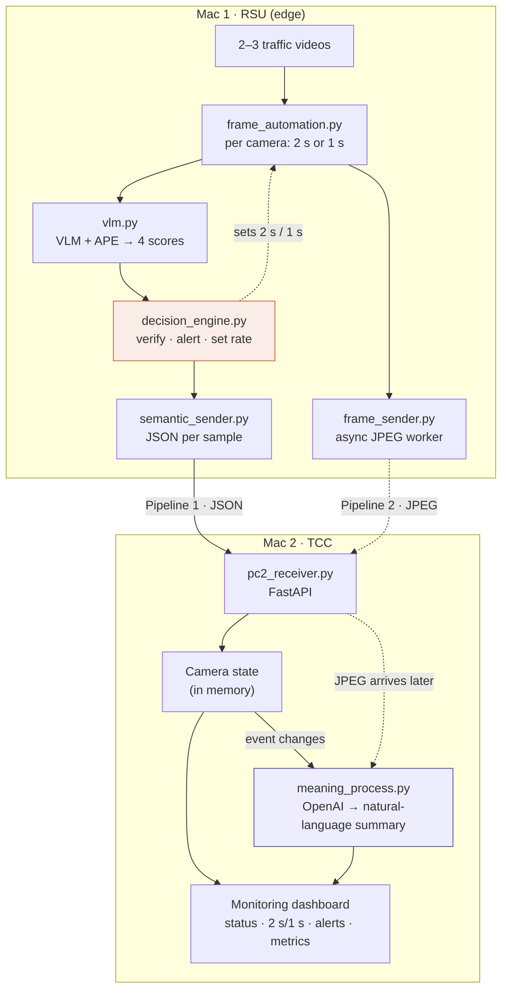

# RoadSense — edge AI traffic monitoring

> Sea x OpenAI Regional Codex Hackathon (Thailand) — 21 Nov 2026
> Team: **khun-chai (TEAM36)** · Tracks: Deep Domain AI · Autonomous & Adaptive AI

RoadSense analyzes CCTV at a simulated roadside unit with a vision-language model + Adaptive Prompt Ensemble,
samples each camera every 2 s and speeds up to 1 s only when it needs to verify an event, and sends compact
semantic results (plus selected snapshots) to a Traffic Control Center dashboard.

- Plan & context: [docs/master-plan.md](docs/master-plan.md)
- Contracts: [docs/api-contract.md](docs/api-contract.md)
- Team workflow: [CONTRIBUTING.md](CONTRIBUTING.md) · Codex rules: [AGENTS.md](AGENTS.md)

## Architecture



- The adaptive loop (`decision_engine` → `frame_automation`) runs on Mac 1 only.
- `meaning_process` (Mac 2) turns JSON into an operator-readable summary with OpenAI first, then refines it when the matching JPEG arrives. It runs async and never delays the dashboard.
- Pipeline 2 never blocks inference (bounded queue, drop stale previews).
- Each sample → 1×4 softmax scores + camera metadata (location from `rsu/cameras.json`) sent as JSON.
- Payload fields and endpoints: [docs/api-contract.md](docs/api-contract.md).

## Provenance
- **Pre-event baseline (reused):** our research code for VLM + APE traffic-state inference (ICOIN 2027 submission). TODO: link baseline repo/commit.
- **Built during the event (from 10:00):** everything under `rsu/`, `tcc/`, `shared/`, `evaluation/`, `tests/`.
- An early scaffold made before hacking started is kept only in tag `pre-event-scaffold` and is **not** part of the submission.

## Run

The OpenCV sampler and VLM baseline are available on this integration branch.
The inference, decision, and transport modules still need to be wired together.

```bash
python3 -m venv .venv
source .venv/bin/activate
pip install -r requirements-frame.txt -r requirements-rsu.txt
python -m rsu.frame_automation --video CAM_01=assets/demo_clips/traffic.mp4
```

This prints frame metadata as JSON, in real time, **every 1 second by default**.
Override with `--interval-sec 2` for the planned normal monitoring rate. Repeat
`--video CAM_02=assets/demo_clips/another.mp4` for independent camera feeds.
Optional `--output-dir /tmp/roadsense-frames` saves sampled JPEGs for inspection;
`--no-realtime` extracts offline as fast as decoding permits. Clips stop at EOF
(or decode failure); Ctrl-C releases the video handles. Video files stay local.
The CLI only extracts frames and does not classify them or send predictions.
The VLM uses the existing `assets/prompts/ape_k30.md` prompts; see
[VLM setup](docs/rsu-baseline.md) for model loading and the input interface.

For the RSU automation loop, use one `FrameSampler` per camera:

```python
from rsu.frame_automation import FrameSampler

with FrameSampler("assets/demo_clips/traffic.mp4", "CAM_01", interval_sec=1) as camera:
    for sample in camera.samples():
        # Pass sample.frame_bgr (OpenCV BGR ndarray) to the VLM wrapper.
        # Feed the real prediction to the decision engine, then apply its
        # sampling interval using camera.set_interval(decision_interval_sec).
        print(sample.metadata())
```

Use `camera.read_due()` in a shared multi-camera scheduler; it returns `None`
when a camera is not due or finished (`camera.exhausted`). Each sample carries
`camera_id`, `frame_id`, `video_timestamp_sec`, ISO UTC `captured_at`, and the
active interval. Convert BGR to RGB in the model wrapper if its preprocessing
expects RGB. Rate hysteresis belongs in the decision engine on Mac 1.

Sampling follows video timestamps (frame index/FPS fallback) with one source
frame of timing precision. Local clips need valid FPS metadata. The sampler
skips stale frames if the consumer falls behind; model speed still determines
end-to-end inference throughput. JPEG disk output is a smoke-test option,
separate from the planned asynchronous network preview sender.

Run the frame extraction tests, including generated-video decoding and real-time pacing:

```bash
python -m unittest discover -s tests -v
```

## Team — khun-chai (TEAM36)
| Name | GitHub | Role |
|---|---|---|
| Chaiyapat Anantarasuchart | [@erthcyp](https://github.com/erthcyp) | TODO |
| Chaitawat Boonkitticharoen | [@fongctw](https://github.com/fongctw) | TODO |
| Kanteeded Limkangwalmongkol | [@kantheedeth](https://github.com/kantheedeth) | TODO |
| Bhuchi Kumprakob | [@Bhuchi](https://github.com/Bhuchi) | TODO |
