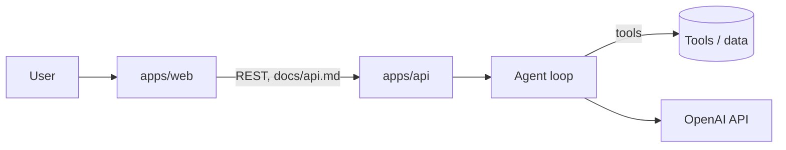

# Architecture

## Components
- **web:** TODO
- **api:** TODO
- **agent:** TODO — tools it can call, how it handles failures/unexpected input (judges care about reliability)

## Responsible AI
- What data we use and where it goes: TODO
- Guardrails / human-in-the-loop: TODO
- Known limitations: TODO
