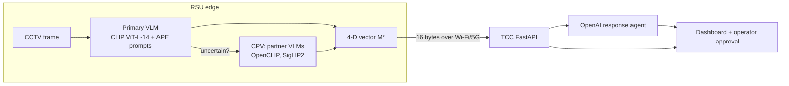

# Architecture

## From the paper (already validated)
- APE: GPT-generated candidate prompts → S-BERT relevance (τr=0.45, τm=0.05) → K-means diversity → 30 prompts/class.
- CPV: verify when s1 < 0.60 and Δ < 0.30; swap Top-1/Top-2 only if both partners agree. Triggered 27.4%, changed 6.4%.
- Mean accuracy 67.16% (SP) → 81.30% (APE) → 84.39% (CPV); best 94.30% (CLIP ViT-L-14).
- 16-byte payload: 4.245 ms mean one-way latency vs 7.153 ms raw image; 3.7% vs 35.3% miss at 5 ms (Wi-Fi 6 testbed).

## New for the hackathon
- **TCC response agent:** turns the verified state + recent history into a structured plan (severity, actions, TH/EN public alert), with human approval for risky actions.
- **Live product demo:** multiple RSUs streaming, dashboard, operator in the loop.

## Responsible AI
- Only the 4-D vector leaves the RSU: no raw images on the network → privacy by design (no faces/plates transmitted).
- Agent can't dispatch on its own; low confidence or CPV-changed labels require a human.
- Limitations: evaluated on 1,000 public-dataset images and a Wi-Fi testbed; no deterministic delay guarantee; real deployment needs local data and cellular testing.
