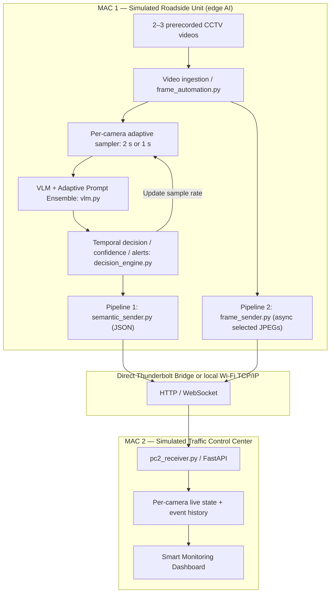

# RoadSense — Hackathon Master Plan & AI Handoff

> **Purpose:** This is the single source of context for any teammate or AI coding assistant working on **RoadSense** during the hackathon. Read this document before proposing architecture, generating code, dividing work, or planning the demo.
>
> **Status:** Planning document, **not** proof that any listed RoadSense modules have already been implemented. The team has **4 Macs for development**, but the **final live demonstration uses 2 Macs** and lasts **only 2–3 minutes**.
>
> **Important distinction:** This file combines (1) event details and rules supplied by the team, (2) the team's RoadSense project description and two-PC sketch, and (3) recommended implementation choices discussed in planning. **Suggestions are not organizer requirements** and should be validated against actual hardware, baseline code, and time constraints.

---

## 1. Executive summary

**RoadSense** is an AI-assisted traffic-monitoring prototype for a Traffic Control Center (TCC). It monitors **2–3 simulated CCTV cameras**, classifies sampled frames into **Normal Flow, Congestion, Accident, or Invalid Scene** using a **Vision-Language Model (VLM) with Adaptive Prompt Ensemble (APE)**, checks predictions across time, and automatically adjusts the **per-camera AI sampling interval** from **2 seconds (normal)** to **1 second (verification)** when needed. It sends **compact semantic predictions** from a simulated **Roadside Unit (RSU)** to a separate TCC machine and sends **selected JPEG previews/event snapshots** through a second, asynchronous pipeline. The dashboard displays each camera's condition, alerts, priority, current sampling interval, and actual efficiency metrics.

**One-line pitch:** *RoadSense performs traffic understanding at the edge, sends meaningful semantic information to the control center, and spends more AI compute only when the situation warrants it.*

**MVP success:** A real end-to-end system running on **two physically separate Macs** over a local network, with **two video feeds**, real VLM/APE predictions, a per-camera sampling-rate change triggered by results, a networked dashboard alert, and measured AI-call reduction against a fixed-rate baseline.

**What this is not:** A production RSU deployment; a required Raspberry Pi/IoT device project; or a system that needs continuous full-resolution video transmission to TCC.

---

## 2. Original project concept (Thai; team-provided)

> ทีมของเราต้องการพัฒนา RoadSense ระบบ AI สำหรับช่วยเจ้าหน้าที่ศูนย์ควบคุมจราจรในการติดตาม วิเคราะห์ และประเมินสถานการณ์จราจรจากกล้อง CCTV หลายตัวพร้อมกัน โดยระบบสามารถจำแนกสภาพจราจรออกเป็น 4 ประเภท ได้แก่ Normal Flow, Congestion, Accident และ Invalid Scene พร้อมแสดงผลและแจ้งเตือนเหตุการณ์ผิดปกติผ่าน Dashboard เพื่อช่วยให้เจ้าหน้าที่สามารถติดตามสถานการณ์และตัดสินใจได้รวดเร็วยิ่งขึ้น เนื่องจากปัจจุบันเจ้าหน้าที่ต้องเฝ้าระวังภาพจากกล้องจำนวนมาก ทำให้ยากต่อการตรวจสอบเหตุการณ์ได้อย่างทั่วถึง นอกจากนี้ การนำวิดีโอทุกเฟรมมาวิเคราะห์ด้วย AI ยังต้องใช้ทรัพยากรประมวลผลสูง แม้ในช่วงที่สภาพจราจรไม่มีการเปลี่ยนแปลงมากนัก
>
> เราจึงเสนอระบบ AI Traffic Monitoring ที่สามารถวิเคราะห์สถานการณ์จราจรและปรับความถี่ในการประมวลผลวิดีโอได้โดยอัตโนมัติ (Adaptive Frame Sampling) โดยระบบจะรับวิดีโอจากกล้อง CCTV แบบต่อเนื่อง และเลือกดึงภาพออกมาเป็นเฟรมตามช่วงเวลาที่กำหนด เช่น ทุก 2 วินาที จากนั้นใช้ Vision-Language Model (VLM) ร่วมกับเทคนิค Adaptive Prompt Ensemble (APE) เพื่อวิเคราะห์และจำแนกสถานการณ์จราจรในแต่ละเฟรมที่เลือก โดยไม่จำเป็นต้องนำทุกเฟรมของวิดีโอเข้าสู่โมเดล AI ตลอดเวลา พร้อมนำผลการจำแนกจากหลายช่วงเวลามาประเมินร่วมกัน เพื่อช่วยตรวจสอบความต่อเนื่องและความน่าเชื่อถือของสถานการณ์ที่ตรวจพบ
>
> จุดเด่นของ RoadSense คือความสามารถในการตรวจสอบและปรับกระบวนการวิเคราะห์ตามสถานการณ์ได้โดยอัตโนมัติ ระบบจะพิจารณาความมั่นใจและความสอดคล้องของผลการจำแนกจากหลายเฟรม หากพบว่าผลการวิเคราะห์ไม่สอดคล้องกัน เช่น เฟรมก่อนหน้าเป็น Normal Flow แต่เฟรมถัดมาเป็น Accident หรือโมเดลมีความมั่นใจต่ำ ระบบจะเพิ่มความถี่ในการดึงภาพ เช่น จากทุก 2 วินาทีเป็นทุก 1 วินาที เพื่อรวบรวมข้อมูลเพิ่มเติมและตรวจสอบสถานการณ์จากหลายเฟรม เมื่อผลการวิเคราะห์มีความสอดคล้องกันอย่างต่อเนื่อง ระบบจะปรับกลับสู่ความถี่ปกติเพื่อลดการใช้ทรัพยากร ทั้งนี้ หากตรวจพบเหตุการณ์สำคัญที่มีความมั่นใจสูง ระบบสามารถแจ้งเตือนเบื้องต้นให้เจ้าหน้าที่ทราบได้ทันที พร้อมดำเนินการตรวจสอบเพิ่มเติม เพื่อช่วยลดความล่าช้าในการรับรู้เหตุการณ์ผิดปกติ
>
> ภายในงาน Hackathon ทีมวางแผนพัฒนา Working Prototype ที่สามารถรับวิดีโอจากกล้องจำลอง 2–3 ตัว วิเคราะห์และจำแนกสถานการณ์จราจรด้วย VLM และ APE ตรวจสอบความสอดคล้องของผลการจำแนกจากหลายช่วงเวลา และปรับความถี่ในการดึงเฟรมแบบอัตโนมัติตามสถานการณ์ พร้อมพัฒนา Smart Monitoring Dashboard สำหรับแสดงสถานะจราจรจากกล้องแต่ละตัว แจ้งเตือนเหตุการณ์ผิดปกติ และจัดลำดับความสำคัญของกล้องที่ควรได้รับการตรวจสอบ เพื่อช่วยลดภาระของเจ้าหน้าที่ เพิ่มประสิทธิภาพในการเฝ้าระวังจราจร และใช้ทรัพยากรในการประมวลผลได้อย่างเหมาะสม

---

## 3. Hackathon rules, schedule, and boundaries

### 3.1 Code preparation rule — supplied by organizer FAQ

> **(5) Can we build or prepare code in advance before the event?**  
> You’re welcome to arrive with ideas or build on existing personal or open-source projects. However, all new development must take place during the event and be significant and substantial. Only work completed during the event will be judged.

**How to apply this rule:**

- **Before the event:** Collect and license-check video assets; make a small annotated test set; review and verify the **existing** RSU project; download model weights/dependencies; test that baseline runs; benchmark laptop performance; plan architecture; define API/interface contracts; practice Codex on unrelated or existing tasks; draft wireframes and pitch outline; inspect/test cable and network capabilities.
- **During the event (10:00 AM–5:00 PM):** Implement **new RoadSense** components: video ingestion/orchestration, adaptive sampler, temporal decision/alerts, network sender/receiver, multi-camera dashboard, metrics, integration, and demo-specific functionality. Commit new development with traceable timestamps/history.
- **Avoid:** Prebuilding the new RoadSense application and presenting it as work produced during the hackathon. Because the exact organizer interpretation can vary, **ask the organizers if uncertain** about prepared/edited datasets, modified existing code, or preregistered artifacts.
- Preserve a clearly identifiable **pre-event baseline commit** of the personal RSU repo, then create new hackathon branches/commits once hacking opens.
- **Codex effectiveness is a judging criterion** per the team-provided briefing. Use Codex visibly for real development, debugging, testing, and code reviews during the event; keep meaningful prompts/commit history. Do not claim AI wrote something it did not.

### 3.2 Official event program (as provided; local event time)

| Time | Event |
|---|---|
| 08:30 | Doors open and registration; all participants expected by 09:00 |
| 09:00 | Breakfast and pre-event setup |
| 09:20 | Welcome and opening |
| **10:00** | **Hacking begins** |
| 12:30 | Working lunch |
| **17:00** | **Code freeze and submissions** |
| 17:15 | Dinner and round-one judging; rotating presentations |
| 19:30 | Finalist presentations |
| 20:30 | Awards and closing |
| 21:00 | Event ends |

**Time budget:** 7 hours from 10:00 to 17:00, including a working lunch. Target a stable demo by 16:00 and reserve 16:30–17:00 for final submissions. Final-round presentations preferably use English according to the team-provided notes. **Exact hackathon date, venue, judging rubric details, and presentation format beyond those supplied are not included in this plan.**

---

## 4. Hardware: four development Macs, two demo Macs

### 4.1 During development

There are **four team members and four Mac computers**. Each member codes in parallel on a separate branch or worktree. Two of those Macs will be designated as the actual demo machines early in the day.

### 4.2 During final demo

- **Mac 1 = simulated Roadside Unit (RSU / edge).** Plays/reads **2–3 traffic video files**, selects frames adaptively, performs VLM + APE inference, maintains temporal decision states, sends semantic results, and optionally sends compressed JPEG previews.
- **Mac 2 = simulated Traffic Control Center (TCC).** Receives semantic messages and optional images, maintains live camera state and alert history, and renders the monitoring dashboard.
- **Mac 3 + Mac 4 = development/backup only; not required for the final demo.**
- **No Raspberry Pi, external IoT device, hardware camera, public cloud, or deployment to an actual roadside device is necessary for the MVP.** If discussing the architecture to judges, describe Mac 1 as **a simulation of RSU edge processing**.

### 4.3 Mac-to-Mac connection

**Preferred if compatible hardware and cable are available:** **Thunderbolt Bridge**, a direct TCP/IP network link using a compatible Thunderbolt-capable USB-C-shaped cable. **A generic USB-C charging cable is not guaranteed to work as a Thunderbolt networking cable.** Test the specific Macs, ports, cable, firewall, and interface before relying on this in a demo.

**Fallback:** Both Macs connect to the same Wi-Fi network (or Ethernet network) and exchange HTTP/WebSocket messages using local IP addresses. Do not depend on the venue Wi-Fi being reliable; a tested private network is preferable.

Example *illustrative* static addresses for a direct bridge, if configured correctly and conflict-free:

| Device | Example bridge IP | Role |
|---|---|---|
| Mac 1 | `192.168.50.1/24` | RSU |
| Mac 2 | `192.168.50.2/24` | TCC |

Connectivity smoke test: `ping 192.168.50.2` from Mac 1; then test `http://192.168.50.2:8000/health`. Use whatever actual addresses macOS assigns if automatic configuration works; examples are **not** assumed live settings.

**Clarification:** This is application-level **network communication over a cable**, not two Macs automatically mounting one another as USB storage. Ordinary Finder/SMB file sharing is optional and **not** the live data path. HTTP POST / WebSocket can carry semantic messages and event JPEGs.

---

## 5. Device-level architecture and data flows

### 5.1 High-level flow



**Important flow correction:** The **adaptive sampling feedback loop is local to Mac 1** (`decision_engine.py -> frame_automation.py`). Mac 2 does not need to command sampling rates to achieve the MVP. The TCC is a monitoring/alert endpoint; the intelligence is executed at the simulated edge.

### 5.2 Two distinct transmission pipelines

| Pipeline | Source & payload | Execution | TCC use |
|---|---|---|---|
| **1 — Semantic** | Classification result, four class scores, camera ID, location metadata, timestamps, sampling interval, state, alert/priority, inference time | Prediction/inference for each selected sample; send network events without blocking other feeds | Live labels, priority, alerts, metrics |
| **2 — Image preview** | JPEG snapshot of **selected** frame, ideally thumbnail/compressed, associated with camera and timestamp | **Asynchronous**, lower frequency than raw video or on event | Camera preview / evidence snapshot |

**Do not** stream all original video frames to PC2 by default; transmitting compact semantics is a core system point. Distinguish between **AI inference reduction** and **network bandwidth reduction**: if sending JPEG images, account for those bytes in bandwidth comparisons. Pipeline 2 should not block inference if Mac 2 is slow or unreachable; use a bounded queue and drop stale previews when appropriate.

### 5.3 What “sync” and “async” mean here

- Within a camera's inference task: sample frame → VLM prediction → decision update is logically **sequential**, so the decision uses the correct frame result.
- Multiple cameras can be scheduled independently (do not require physically parallel VLM inference on a laptop).
- Semantic network sending and image preview sending should be **nonblocking/asynchronous relative to the inference scheduler** wherever practical.
- On resource-constrained laptops, serialize calls to the model while preserving **per-camera scheduling and state**; document queue delay separately from inference execution time.

---

## 6. Traffic classes, model, and APE

The four traffic categories from the attached **`RSU.pdf` Prompt Lexicon** are:

1. **Accident:** visible collisions, damaged vehicles, crash debris, blocked lanes caused by crashes, emergency responses.
2. **Normal Flow:** moving, unobstructed, low-to-moderate-density traffic, with spacing and no evident queue/incident.
3. **Congestion:** high density, vehicle queues, reduced or stopped movement, stop-and-go traffic or gridlock.
4. **Invalid Scene:** unusable/irrelevant/degraded frames—blocked lens, blur, extreme darkness/glare, non-road scenes, missing/corrupt feed, etc.

**Suggested fixed vector ordering for all interfaces:**

```text
[normal_flow, congestion, accident, invalid_scene]
```

The team must **agree once** and use this order everywhere—model output, API schema, database, charts, and tests. It is an implementation convention for this hackathon, **not** a value mandated by the lexicon. The existing RSU code may use a different order: explicitly map its output rather than silently reindexing.

### 6.1 Baseline work to reuse

The team has an earlier **RSU semantic communication/classification project** containing concepts/code for CLIP-style vision-language zero-shot classification, sentence-embedding-based prompt selection, class prompt ensembles, confidence/decision logic, and an evaluation harness. The team has discussed CLIP, OpenCLIP, and SigLIP/SigLIP2 as candidate models; use the **best already tested model that can run reliably on the actual Mac**. The previously discussed RSU prompt work included 2,000 generated prompts (500 per class) and SBERT/KMeans diversity selection, but **do not regenerate or train this whole pipeline during the hackathon unless the existing implementation truly requires it**.

**APE (Adaptive Prompt Ensemble):** Use the existing validated set(s) of descriptive class prompts to score images with the VLM, aggregate prompt similarities per class using the repo's known method, and return a predicted class + four score values. The exact APE aggregation, score normalization, and prompt set must be verified from the existing code; do not invent or silently substitute one.

**Source distinction:** `RSU.pdf` is a **prompt lexicon**, not an authoritative description of the entire RoadSense software architecture. The PDF refers to generating prompts and a BERT-based prompt-classifier workflow, while the hackathon plan explicitly calls for a **VLM + APE inference pipeline**. Do not conflate a BERT prompt classifier with image inference in CLIP/SigLIP.

### 6.2 Model output contract (proposed)

```python
def predict(frame) -> dict:
    """Return camera-independent VLM result for one selected image frame."""
    return {
        "prediction": "congestion",
        "scores": [0.05, 0.84, 0.08, 0.03],
        "score_order": ["normal_flow", "congestion", "accident", "invalid_scene"],
        "confidence": 0.84,
        "inference_ms": 85.2,
        "model_name": "example-model"
    }
```

**The values above are illustrative only.** If scores are normalized (e.g. softmax) they may sum to 1; raw cosine scores generally do not. Do not call raw similarities calibrated probabilities. If using a “confidence” threshold, document exactly how it is computed and tune it using test frames.

---

## 7. Adaptive sampling and temporal decision (core innovation)

### 7.1 Recommended MVP state machine (proposed, not yet validated)

- **NORMAL:** select one frame per camera roughly every **2 seconds**.
- **VERIFY:** select one frame roughly every **1 second** for the affected camera after a class change, low-confidence result, suspected anomaly, or inconsistent recent predictions.
- **ALERT / ACTIVE EVENT:** maintain/notify an event if repeated frames support it. A high-confidence Accident may issue an **immediate preliminary alert** while verification continues.
- **RECOVERY:** after the condition returns to stable normal and is consistently classified, return the affected camera to **2-second sampling**.
- **INVALID:** surface a camera-quality warning; do not confuse bad image quality with a confirmed traffic incident.

Suggested starting conditions:

| Condition | Suggested action |
|---|---|
| Stable Normal Flow | Maintain 2s/frame |
| Confidence below **0.60** | Increase to 1s/frame and mark verifying |
| Predicted class changes unexpectedly | Increase to 1s/frame, verify subsequent frames |
| High-confidence Accident | Send a **preliminary** alert immediately, then verify |
| Multiple consistent event predictions | Mark event confirmed; raise camera priority |
| **3 consecutive stable Normal Flow predictions** after an event | Return to 2s/frame, with cooldown to prevent rapid toggling |
| Invalid Scene / camera lost | Show camera availability/quality warning |

**These thresholds and counts are heuristics only.** A 0.60 model score is not intrinsically “60% accurate.” Choose thresholds after observing score distributions from the real VLM. Confirmation and recovery requirements may need different counts or time windows; use timestamps, not only frame indices. Include cooldown/hysteresis so the rate does not flap rapidly. A persistent congestion event might justifiably remain in higher-priority monitoring even after initial confirmation; define the rule explicitly and be ready to defend it.

### 7.2 Crucial implementation rules

- Maintain **independent state per camera**: history, sample interval, state, recent confidence, active event, priority, and last alert ID/time.
- Timestamp frames using their **video playback time** and record wall-clock capture/receive times separately.
- Do not use hidden ground truth or filename labels to drive classification or sampling in the live demo.
- Use a simulated source clock / real-time playback mechanism; loop prerecorded clips seamlessly if needed.
- Clearly distinguish **preliminary** and **confirmed** alerts and suppress repeated duplicate alerts.
- If the VLM fails or camera input disconnects, show an explicit error/invalid state instead of fabricated predictions.

### 7.3 Example minimal pseudocode

```python
for camera in cameras:
    if camera.is_due(now):
        frame = camera.read_current_frame()
        prediction = vlm.predict(frame)
        decision = decision_engine.update(camera.camera_id, prediction, now)
        camera.set_interval(decision.sampling_interval_sec)
        semantic_queue.put(decision.to_payload())
        if decision.send_snapshot:
            preview_queue.put(compress_jpeg(frame))
```

This is a specification sketch, **not a prebuilt hackathon implementation**.

---

## 8. API and message contracts (agree before implementation)

### 8.1 Semantic update example

```json
{
  "schema_version": "1.0",
  "message_type": "semantic_update",
  "camera_id": "CAM_02",
  "location": {"label": "Example Junction", "latitude": null, "longitude": null},
  "frame_id": "CAM_02-000074",
  "video_timestamp_sec": 74.0,
  "captured_at": "2026-11-21T10:42:15+07:00",
  "predicted_class": "congestion",
  "score_order": ["normal_flow", "congestion", "accident", "invalid_scene"],
  "scores": [0.05, 0.84, 0.08, 0.03],
  "confidence": 0.84,
  "inference_ms": 85.2,
  "sampling_interval_sec": 1.0,
  "verification_state": "verifying",
  "alert": {"level": "preliminary", "type": "congestion", "message": "Congestion suspected"},
  "priority": "high"
}
```

**All values, addresses, locations, timestamps, and scores here are examples, not recorded project measurements or actual demo camera locations.** Metadata such as location remains a separate JSON field: it is **not** one of the four similarity-vector dimensions.

### 8.2 Optional snapshot metadata

```json
{
  "camera_id": "CAM_02",
  "frame_id": "CAM_02-000074",
  "video_timestamp_sec": 74.0,
  "content_type": "image/jpeg",
  "event_id": "event-002"
}
```

Send compressed JPEG bytes in a multipart upload or binary WebSocket message; choose a simple convention and document it. Link image to semantic event via `camera_id` + `frame_id` or `event_id`.

### 8.3 Suggested endpoints (not implemented yet)

| Method/path | Purpose |
|---|---|
| `GET /health` | Receiver health/readiness and version |
| `POST /api/v1/semantic` | Mac 1 sends prediction/update to Mac 2 |
| `POST /api/v1/snapshot` | Mac 1 uploads selected JPEG preview |
| `GET /api/v1/cameras` | Dashboard gets latest state of each camera |
| `GET /api/v1/alerts` | Dashboard gets alert history |
| `GET /api/v1/metrics` | Dashboard gets measured counters |
| `WS /ws` | Optional push channel for live UI updates |

**Mac 2 server command (if FastAPI/uvicorn is selected):**

```bash
uvicorn pc2_receiver:app --host 0.0.0.0 --port 8000
```

**Mac 1 base URL example:** `http://192.168.50.2:8000` (update to actual IP). Handle timeout/retry in the sender; preserve message order or add monotonically increasing frame IDs so stale messages do not overwrite newer ones.

### 8.4 Persistence

For the MVP, **in-memory state is enough** for current camera results and a short event history. **SQLite is optional** for replayable logs. Do not let database setup block the dashboard.

---

## 9. Project modules, repository layout, and responsibilities

### 9.1 Proposed layout

```text
roadsense/
├── README.md
├── docs/
│   ├── architecture.md
│   ├── api-contract.md
│   └── demo-script.md
├── assets/
│   ├── manifests/               # metadata; avoid committing large raw videos
│   └── demo_clips/              # local or appropriately licensed media
├── rsu/                         # Runs on Mac 1
│   ├── frame_automation.py      # video ingest, per-camera timing, frame extraction
│   ├── vlm.py                   # existing-model wrapper + APE integration
│   ├── decision_engine.py       # temporal decisions / alerts / rate control
│   ├── semantic_sender.py       # JSON outbound
│   ├── frame_sender.py          # async JPEG previews
│   └── main.py                  # camera orchestration
├── tcc/                         # Runs on Mac 2
│   ├── pc2_receiver.py          # FastAPI receiver
│   ├── camera_state.py          # live state / alert history
│   ├── database.py              # OPTIONAL SQLite
│   └── dashboard/               # React/Vite app OR Streamlit alternative
├── shared/
│   └── schemas.py               # authoritative class/order/payload schema
├── evaluation/
│   ├── fixed_sampler.py
│   ├── compare_modes.py
│   └── test_set_manifest.csv
├── tests/
│   ├── test_decision_engine.py
│   ├── test_payload_schema.py
│   ├── test_receiver.py
│   └── test_integration.py
└── requirements.txt
```

These names are **suggestions** derived from the team's hand-drawn plan, not exact filenames already known to exist. Adapt to the existing repo instead of duplicating/rebuilding stable parts.

### 9.2 Four-person split across four Macs

| Person | Ownership during coding | Deliverable |
|---|---|---|
| **P1 — VLM / Video Engineer** | Adapt existing VLM + APE, video read, per-frame prediction, frame automation interface, latency benchmarks | Tested `predict(frame)` and per-camera frames feeding inference |
| **P2 — Adaptive Decision Engineer** | Confidence/temporal logic, per-camera state machine, dynamic sampling interval, alert triggers; cooperate with P3 on senders | Unit-tested `decision_engine.py`, semantic/snapshot event specification |
| **P3 — Network / Backend Engineer** | Mac-to-Mac networking, `semantic_sender.py` + `frame_sender.py`, FastAPI `pc2_receiver.py`, schemas, camera state | JSON + JPEG successfully received on actual second Mac |
| **P4 — Dashboard / Integration / Pitch Lead** | TCC UI, camera cards, alerts, ranking, metrics; integrate all modules; rehearse pitch | Complete monitoring dashboard and repeatable 2–3-minute demo |

**Alternative if skill distribution demands:** P2 owns senders and P3 owns receiver + camera state (the original four-person plan). The key is **exactly one owner per interface and one integration lead**, not the particular name assignment. P4 is a reasonable role for the project's RSU/solution-architecture lead, but this is a suggestion rather than an explicit team assignment.

### 9.3 Shared engineering conventions

- Establish the **class order**, JSON keys, normalization of scores, camera IDs, timestamp types, and alert states **before parallel coding**.
- Create branches such as `feature/rsu-inference`, `feature/decision-engine`, `feature/network-api`, `feature/dashboard`. Avoid multiple teammates rewriting `main` simultaneously.
- P3 publishes stub/mock JSON early so P4 can build UI independently. Later replace mocks with the real RSU feed.
- Integrate incrementally: **one camera end-to-end first**, then two cameras and dynamic control, then metrics and polish.
- Have a reproducible startup checklist/scripts; identify which two of four Macs are the demo pair and install all dependencies there.

---

## 10. Recommended technology stack

| Layer | Recommended | Notes |
|---|---|---|
| Video decoding | Python + OpenCV | Load mp4 clips, seek/play with timestamps; use valid clip frames |
| Image inference | Existing CLIP / OpenCLIP / SigLIP(2) + APE | Prefer verified latency/reliability over novelty |
| RSU orchestration | Python | Per-camera sampling state and asynchronous send queues |
| TCC API | FastAPI + Uvicorn | Small local HTTP receiver; WebSockets optional |
| Dashboard | React + Vite **if familiar**; else Streamlit | Choose before event, avoid major stack switching |
| Storage | In-memory initially | SQLite only if time allows |
| Connectivity | Thunderbolt Bridge or private Wi-Fi | TCP/IP; test the actual cable and IPs |
| Dev workflow | GitHub + Codex | Use Codex substantially **during** hacking |
| Hosting | Two local Macs | No cloud requirement |

**Performance guidance:** On Apple Silicon, test CPU/MPS support and memory usage against the actual chosen VLM. Cache model weights locally well before the event; venue internet might be slow. Avoid having multiple Macs simultaneously download gigabytes of weights on demo day.

---

## 11. Data assets and evaluation preparation

### 11.1 Video requirements

- Collect **at least 3 usable clips**, ideally **4–6**, that together cover all four classes; choose footage representative of CCTV/roadside fixed-angle views when possible.
- Use public datasets or appropriately licensed footage (YouTube, publicly accessible traffic camera, or dashcam material only where reuse/demo permissions allow). Retain source/license information.
- Trim into loopable clips / known short scenarios for **2–3 camera feeds**; ensure continuity, image dimensions, frame rate, and decoding work on Mac 1.
- Check that the existing VLM actually classifies the selected clips sensibly. A high-quality demo relies more on predictable, real model behavior than on exciting footage.
- Assemble a small **20–50 frame labeled sanity-check set**, with examples from **all four classes**. Use this to detect obvious misclassification but do not claim this is rigorous external validation.
- Maintain separate **video source timestamps**, known event onset timestamps, and ground-truth labels for evaluation; **never feed ground-truth labels to the live classifier**.

### 11.2 Example demo scenario (illustrative)

| Feed | First segment | Event segment | Recovery |
|---|---|---|---|
| Camera 01 | Normal Flow | Remains Normal Flow | Normal Flow |
| Camera 02 | Normal Flow | Congestion (or visible Accident) | Returns to Normal Flow |
| Camera 03 (optional) | Normal or Invalid | Optional bad camera / alternate incident | Optional |

An example camera-2 file could contain **20s Normal → 30s Congestion → 20s Normal**. Use actual known/verified frame content and a model-tested transition; these durations are examples. Consider video playback time rather than waiting a full 70+ seconds if the demo needs to be compact; the actual model and rules must still process the shown evidence.

---

## 12. Feature priorities and measurable acceptance criteria

### 12.1 Priorities

**P0 — Must work:**

- [ ] Two simulated camera sources on Mac 1.
- [ ] Real VLM + APE inference producing one of four classes.
- [ ] Independent per-camera scheduling, normally every 2s.
- [ ] An actual condition-driven switch to 1s, followed by evidence-based return to 2s.
- [ ] Temporal consistency verification; preliminary/confirmed alerts where applicable.
- [ ] Mac 1 to Mac 2 working network transport carrying semantic JSON.
- [ ] Mac 2 dashboard shows camera status, current interval, alerts, and at least selected preview images.
- [ ] Count real VLM inferences and show measured reduction against fixed 1s sampling.

**P1 — Highly desirable:**

- [ ] Camera priority ordering (e.g. Accident > Congestion > Normal; Invalid separately as camera-health problem).
- [ ] Snapshot transmission with matched frame IDs.
- [ ] Fixed-vs-adaptive comparison and event detection delay.
- [ ] Robust retries, stale-result handling, and duplicate-alert suppression.

**P2 — Optional if ahead of schedule:**

- [ ] Third camera feed.
- [ ] SQLite history.
- [ ] API-based second VLM verification.
- [ ] Cloud hosting, user accounts, other non-core infrastructure.

**Avoid building a Raspberry Pi/physical IoT prototype or a full production data platform merely for novelty.** The hackathon proof point is RSU→TCC architecture plus adaptive semantic processing.

### 12.2 Definitions of done

- **Inference is real:** With the same loaded model, model scores change appropriately with different real video frames. No hardcoded event labels for demo logic.
- **Adaptive behavior is real:** Logs record sampling interval changes based on model/decision outputs; Camera 1 remains at 2s when only Camera 2 is affected.
- **Network is real:** Stop the TCC receiver and observe delivery failures; restart and verify recovery. Demonstrate that the dashboard reads real messages from Mac 1, not a local UI-only simulation.
- **Snapshots are decoupled:** Large JPEG upload or lost link should not stall the RSU inference loop.
- **Metrics are real:** Counters/latencies come from runtime logs, not invented infographic percentages.
- **Demo is reliable:** Can restart both processes and replay the scenario within the presentation time; a pre-recorded backup video exists for failure recovery and is disclosed if used.

---

## 13. Evaluation and claims to make accurately

### 13.1 Core metrics

1. **AI inference count:** `N_adaptive` actual model invocations across all cameras and period.
2. **Fixed-rate baseline:** `N_fixed_1s` for the *same clips, playback duration, hardware, and models* sampled every 1 second.
3. **AI-call reduction:** `100 * (1 - N_adaptive / N_fixed_1s)` percent.
4. **Inference latency:** elapsed execution time per `predict()` invocation; show distribution (median/p95) if enough samples exist.
5. **Event detection delay:** time from labeled incident onset in playback to first alert; note preliminary vs confirmed if both are measured.
6. **Classification performance:** correct predictions / labeled samples, plus per-class accuracy if meaningful; small test set is a sanity check only.
7. **Communication efficiency (optional):** sum bytes sent via **both** pipelines compared to a clearly defined raw-video/image baseline. Count JSON, JPEG, and network protocol assumptions consistently.
8. **False alarms / missed incidents:** distinguish what is actually measured from what is merely intended.

**Key interpretation:** Switching from 1s sampling to 2s sampling can reduce the sampling/inference *rate* by up to about half during stable intervals, **but the measured overall reduction depends on time spent verifying, overhead, video length, and actual inference counts**. Never present a fabricated “38% compute saved” or other illustrative mockup number as a measured result. Reducing model-call count does not automatically prove equal accuracy or proportional energy savings.

### 13.2 Benchmarks to prepare

- Time `predict(frame)` for representative frames on the exact Mac 1.
- Observe clip playback speed and inference scheduling backlog under 2 cameras.
- Measure JSON bytes per message, JPEG sizes, and receiver latency.
- Ensure actual event durations are long enough for the sampler to detect them at the configured interval.

---

## 14. Day-of implementation plan (10:00–17:00)

| Time | Team objective | Gate / output |
|---|---|---|
| 08:30–10:00 | Registration, adapters/cable/network, dependencies, video/model assets, repository check; **do not begin new judged work before permitted start** | Everyone set up |
| **10:00–10:20** | Kickoff, branches, shared schema, class order, chosen VLM, commit baseline reference | Contract agreed |
| 10:20–11:45 | Parallel implementation (P1 model/video, P2 decision, P3 transport, P4 dashboard) | Individual components testable |
| **11:45–12:30** | Integrate **one** video → real AI → network → dashboard | **Milestone 1: first end-to-end camera** |
| 12:30–13:30 | Working lunch; add independent second camera and live preview | Two feeds |
| **13:30–14:30** | Implement connected adaptive sampling + temporal verification + alerts | **Milestone 2: dynamic 2s↔1s works** |
| 14:30–15:15 | Add actual counters, priority, fixed-rate comparison, maybe third camera | Measured metrics |
| **15:15–16:00** | Test all four classes, failure/restart behavior, snapshot sync, network recovery | **Milestone 3: demo-ready** |
| 16:00–16:30 | Prepare final English talk track, rehearse 2–3 min, capture permitted demo backup | Rehearsed |
| 16:30–17:00 | Final git commits, README, links, submission, code-freeze checks | **Submit by 17:00** |

**Cut scope rapidly if behind:** Prioritize one working integrated camera by lunch; then second camera; then adaptive proof; then metrics; then UI improvements. A clean two-camera system is better than a broken three-camera showcase.

---

## 15. Final live demo — strictly 2–3 minutes

**Target: 2 minutes 30 seconds** including speaking and screen transitions, with up to 30 seconds buffer. All model weights and servers should be loaded and both Macs already connected before speaking. Two people operate/narrate; the other two monitor technical stability and assist with questions.

| Demo time | Action | What judges should see |
|---|---|---|
| **0:00–0:20** | Show Mac 1 (simulated RSU) and Mac 2 (TCC) connected | Two physical devices; semantic edge-to-center architecture |
| **0:20–0:45** | Start/point to two camera panels in Normal Flow | Both show 2s/frame and real recent model outputs |
| **0:45–1:15** | Camera 2 reaches known Congestion/Accident segment | Prediction changes or becomes uncertain; **Camera 2 switches 2s→1s**, Camera 1 stays 2s |
| **1:15–1:45** | Show temporal verification and networked event | Alert feed + high-priority Camera 2 + optional JPEG snapshot from Mac 1 |
| **1:45–2:10** | Camera 2 scene stabilizes/returns to normal | After consistent frames, Camera 2 returns to 2s/frame |
| **2:10–2:30** | Show actual benchmark panel | Real AI calls vs fixed 1s baseline, reduction, inference/event latency |

### 15.1 Short English narration (suggested)

> “This is RoadSense, an AI traffic-monitoring prototype. Our first Mac simulates a roadside unit and performs traffic analysis locally; the second Mac represents the Traffic Control Center. Normally, each camera is analyzed every two seconds. When Camera 2 shows congestion, RoadSense automatically increases its sampling rate to once per second to verify the event, while the other camera stays at its normal rate. Only semantic results and selected snapshots are sent to the control center, where operators see an alert and the camera's priority. When conditions recover, RoadSense returns to the slower interval. Finally, here are our **measured** inference calls, detection delay, and processing savings compared with fixed-rate analysis.”

If measured data are not yet available, do not insert numbers. A single person should lead narration and another operate; skip server startup, dependency installs, or lengthy code walkthroughs during the 2–3-minute window. Showcase **actual live inference** rather than a prerecorded UI animation. If showing a backup recording, label it explicitly.

### 15.2 Suggested demo screen

- Two or three camera cards: video preview, class, confidence/score descriptor, 2s/1s sampling rate, last update.
- Event feed: camera, time, preliminary/confirmed, severity.
- Camera priority ranking: which feed the operator should check first.
- Bottom metrics: AI calls, fixed-rate baseline calls, observed reduction, inference latency and detection delay.
- A visible indication that the RSU and TCC are separate computers (e.g. terminal/IP/connection status), not just two browser windows on one Mac.

---

## 16. Technical and presentation risks with fallbacks

| Risk | Mitigation/fallback |
|---|---|
| Thunderbolt cable is charge-only or bridge unsupported/misconfigured | Test early; fallback to both Macs on the same tested Wi-Fi or Ethernet network |
| macOS firewall / wrong IP prevents POSTs | Verify ping, `/health`, bind server to `0.0.0.0`, inspect network interfaces, check firewall permissions |
| VLM model too slow for 2–3 feeds | Choose lighter already-validated model; shrink frame resolution, keep only two cameras, serialize inference with scheduler |
| Model wrongly classifies chosen demo clip | Test assets **before** event against baseline; select clearer clips; preserve honest evaluation; don't hardcode labels |
| Confidence scale unsuitable for 0.60 threshold | Measure output distributions and tune/disable numeric threshold; use disagreement trigger as fallback |
| Rapidly fluctuating class/rate (“flapping”) | Multi-frame temporal check, cooldown/hysteresis, duplicate alert suppression |
| Network/snapshot upload blocks inference | Bounded asynchronous send queue, compress JPEG, drop stale preview, retry semantic events with limits |
| Event segment is missed by 2s sampling | Ensure event lasts several seconds, verify clip timestamps and playback; do not script artificial inference success |
| UI and server incompatible schemas | Shared schema + mocked payload at kickoff; automated contract tests |
| No database available | Use in-memory per-camera state; database is optional |
| Demo crashes or takes too long | Restart scripts; preloaded models; short deterministic real-video scenario; labeled backup recording |
| Judge asks about IoT/6G | Explain simulation: edge AI + semantic messages is demonstrated over local TCP/IP; not claiming real 6G radios or production RSU hardware |
| Claims of savings sound inflated | Show logs, baseline denominator, how JPEG bytes count, and small-sample evaluation caveats |

---

## 17. Pre-event readiness checklist

### Data/assets

- [ ] 3+ traffic clips, ideally 4–6, covering Normal Flow / Congestion / Accident / Invalid Scene.
- [ ] Footage permissions/licenses and sources noted.
- [ ] Clip timestamps, playback behavior, frame rate, and loopability tested.
- [ ] 20–50 labeled test frames with all four classes.
- [ ] Copy of assets on both appropriate devices or external USB as backup.

### Existing RSU baseline

- [ ] Verify inherited model + APE pipeline runs **without new RoadSense features**.
- [ ] Freeze/document baseline commit and list reused parts.
- [ ] Model weights saved offline; compatible dependencies listed.
- [ ] Test representative inference speed and memory usage on Mac 1.

### Architecture and team coordination

- [ ] Agree exact shared prediction schema and four-class ordering.
- [ ] Confirm four roles, ownership, integration point, and two demo Mac assignments.
- [ ] Choose React or Streamlit; FastAPI receiver API shape; choose HTTP/WebSocket approach.
- [ ] Paper design for adaptive states, thresholds, verification, and cooldown.
- [ ] Dashboard wireframe and final English 2–3-minute pitch skeleton.

### Logistics

- [ ] Confirm all registrations under same team name and arrival by 09:00.
- [ ] Four Mac laptops, chargers, HDMI/USB-C display adapter, possible USB drive.
- [ ] Compatible **Thunderbolt networking cable** if using direct bridge; verify both Macs support setup; Wi-Fi fallback.
- [ ] Python and GitHub/Codex authentication, editor, local packages prepared as permitted.
- [ ] Know the 17:00 code-freeze/submission procedure.

---

## 18. Key decisions vs still-open choices

| Item | Status |
|---|---|
| Project name: **RoadSense** | **Confirmed by team** |
| 4 traffic classes | **Confirmed by team and `RSU.pdf` lexicon** |
| 4 developers with 4 Macs | **Confirmed by user** |
| Final demo on 2 Macs (RSU + TCC) | **Confirmed by user** |
| Final live demo only 2–3 minutes | **Confirmed by user** |
| 2–3 simulated CCTV cameras | **Team goal**; 2-camera MVP preferred |
| Edge VLM + APE, temporal consistency, adaptive 2s↔1s | **Team concept**; exact model/rules unvalidated |
| Two pipelines: semantic predictions + async image snapshots | **From team's handwritten architecture and discussion** |
| Direct Thunderbolt Bridge | **Proposed**, depends on the exact Macs and cable; Wi-Fi fallback |
| Python/OpenCV/FastAPI + React/Streamlit | **Recommended**, not mandated |
| Confidence <0.60; 3 stable results to revert | **Suggested starting heuristics**, must be tested |
| Fixed vector class order | **Proposed convention**, align with old repo |
| SQLite | **Optional** |
| Raspberry Pi or physical IoT sensor | **Not required for current MVP** |
| Exact date, camera locations, final datasets, chosen model, team names, hardware specs | **Not confirmed in provided plan** |

---

## 19. Instructions for an AI teammate or coding assistant

1. **Treat this file as project context, not as evidence that code already exists.** Inspect the current repository before suggesting edits.
2. Preserve the hackathon integrity boundary: **new, significant RoadSense development happens during the official event**; reuse existing personal/open-source baseline transparently.
3. Prioritize a genuine, networked, **two-Mac** MVP. The four Macs refer to developer workstations, not four demo nodes.
4. Never assume a Raspberry Pi, a cloud backend, a 6G radio, or a physical roadside camera exists.
5. Preserve the **two transmission pipelines** (semantic JSON and asynchronous selected JPEGs), but never allow the image pipeline to block core inference.
6. Keep **per-camera sampling and state separate**. The loop from decision to sampler happens on **Mac 1**.
7. Before implementing, agree on the **four-class output order**, score meanings, JSON contract, clock/timestamp semantics, and feature flags.
8. Prefer a validated existing CLIP/OpenCLIP/SigLIP + APE pipeline, not a new unproven VLM architecture.
9. The final demo is **2–3 minutes**. Optimize code for deterministic repeatability, minimal setup actions, and a visible normal → event → verify → alert → recover → measured-results journey.
10. Do not invent confidence accuracy, latency, bandwidth savings, detector performance, or dataset permissions. Separate measured results from illustrative examples.
11. Build testable components with independent mocks/stubs, then connect real inference and network data as early as possible.
12. Keep the story centered on **edge semantic inference**, **adaptive compute**, **reduced operator load**, and **useful alerts**—without overstating real-world deployment readiness.

### Questions to resolve internally at 10:00, without expanding scope

- Which exact Mac 1, Mac 2, cable/network route, and Python environment are working?
- Which already-tested VLM model and prompt aggregation will run, with what per-frame latency?
- What normalized score/confidence semantics will thresholds use?
- What are exact `camera_id`, class order, timestamp field, and alert states?
- Will selected images use a separate HTTP POST endpoint or a WebSocket?
- Who owns each integration interface, and how will demo run scripts start reliably?

---

## 20. Source and provenance notes

- **Team messages in the RoadSense project:** primary basis for goals, four Macs/two demo Macs, architecture preferences, event schedule, 2–3-minute demo, pre-event rules, and tech planning.
- **Hand-drawn two-PC sketch supplied by user:** Mac 1/RSU: `frame_automation.py`, `VLM.py` (text prompts + frames), `pc2.py` outputting a `1×4 vector + location`, and `frame_sender.py`; Mac 2/TCC: `pc2_receiver.py`, database to check location, dashboard UI; connection noted as local Type-C connection. The refined architecture separates location metadata from the vector and specifies the cable/network caveat.
- **`RSU.pdf` (uploaded PDF, 6 pages):** Prompt Lexicon supporting the four class definitions and example visual cues; does **not** establish complete app architecture or completed implementation.
- **Earlier RSU research/project discussions:** existing zero-shot CLIP/SigLIP, SBERT prompt clustering and prompt ensemble, four-class reasoning. Verify actual implementation and method in current repository rather than treating planning notes as source code.

**End of RoadSense AI handoff.**
